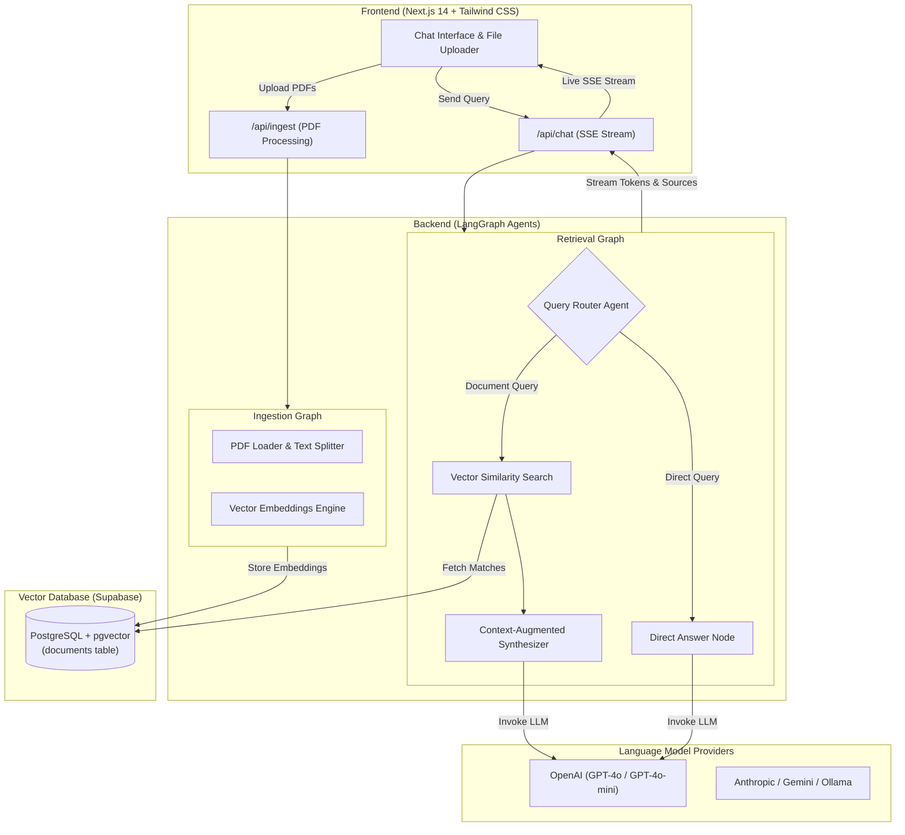

# Manu AI Chatbot 🤖

[](LICENSE)
[](https://nextjs.org/)
[](https://js.langchain.com/)
[](https://langchain-ai.github.io/langgraphjs/)
[](https://www.typescriptlang.org/)
[](https://tailwindcss.com/)
[](https://supabase.com/)

**Manu AI Chatbot** is an enterprise-ready, full-stack conversational AI platform and document intelligence system. Powered by **Next.js**, **LangChain**, and **LangGraph**, it enables users to ingest PDF documents, perform high-precision semantic search with **Supabase Vector Store (pgvector)**, and generate real-time answers with verified source citations.

---

## 🌟 Key Features

- **🧠 Agentic LangGraph Workflows**: Orchestrates document indexing and conversational retrieval using cyclical state machine graphs for maximum determinism and reliability.
- **📄 Multi-Document Ingestion**: Upload and parse single or multiple PDF documents with automatic page-level chunking, metadata extraction, and vector embedding generation.
- **🔀 Smart Query Routing**: Employs an intelligent routing agent that determines whether an incoming query requires contextual vector retrieval or can be answered directly.
- **⚡ Real-Time SSE Streaming**: Delivers instant, low-latency token streaming using Server-Sent Events (SSE) alongside live progress updates and citations.
- **🔍 Verified Citations & Source Viewer**: Each retrieved answer includes expandable citation cards referencing specific document filenames and page numbers.
- **🌐 Broad Model Compatibility**: Easily switch between LLM providers (OpenAI GPT-4o, Anthropic Claude, Google Gemini, Ollama, DeepSeek, Groq, and more).
- **🎨 Modern, Responsive UI**: Crafted with Next.js 14 App Router, Tailwind CSS, Radix UI accessible primitives, and Lucide icons.
- **🚀 Monorepo Architecture**: Managed via Turborepo for synchronized builds, linting, and dependency orchestration across backend and frontend workspaces.

---

## 🏗️ System Architecture



---

## 📁 Repository Structure

```text
Manu_ai_Chatbot/
├── backend/                        # LangGraph agent service & ingestion pipelines
│   ├── src/
│   │   ├── ingestion_graph/        # Graph for document indexing & chunking
│   │   │   ├── configuration.ts
│   │   │   ├── graph.ts
│   │   │   └── state.ts
│   │   ├── retrieval_graph/        # Graph for query routing & RAG response generation
│   │   │   ├── configuration.ts
│   │   │   ├── graph.ts
│   │   │   ├── prompts.ts
│   │   │   ├── state.ts
│   │   │   └── utils.ts
│   │   ├── shared/                 # Shared utilities, configuration, and vector stores
│   │   │   ├── configuration.ts
│   │   │   ├── retrieval.ts
│   │   │   ├── state.ts
│   │   │   └── utils.ts
│   │   └── sample_docs.json        # Default sample documents for bootstrap testing
│   ├── __tests__/                  # Unit and integration test suites
│   ├── demo.ts                     # CLI streaming test script
│   ├── ingest-demo.ipynb           # Interactive ingestion Jupyter notebook
│   ├── langgraph.json              # LangGraph CLI deployment manifest
│   ├── package.json
│   └── tsconfig.json
│
├── frontend/                       # Modern Next.js 14 web application
│   ├── app/
│   │   ├── api/
│   │   │   ├── chat/route.ts       # SSE streaming chat proxy endpoint
│   │   │   └── ingest/route.ts     # PDF ingestion route
│   │   ├── globals.css             # Tailwind base styles and theme tokens
│   │   ├── layout.tsx              # Root HTML layout and metadata
│   │   └── page.tsx                # Main chat dashboard UI
│   ├── components/                 # UI components and Radix widgets
│   │   ├── chat-message.tsx        # Message bubble with citation accordions
│   │   ├── example-prompts.tsx     # Quick-start action prompt cards
│   │   ├── file-preview.tsx        # Uploaded file badge preview
│   │   └── ui/                     # Accessible UI component library
│   ├── constants/                  # Graph configurations and model selections
│   ├── lib/                        # LangGraph clients and PDF helpers
│   ├── types/                      # TypeScript definitions for graph states
│   └── package.json
│
├── scripts/                        # Utility verification and CI scripts
│   └── checkLanggraphPaths.js      # LangGraph configuration validator
│
├── .github/workflows/ci.yml        # Continuous Integration (format & lint)
├── turbo.json                      # Turborepo build pipeline configuration
├── package.json                    # Monorepo root configuration
├── LICENSE                         # MIT License
└── README.md                       # Project documentation
```

---

## 🛠️ Prerequisites

Before getting started, make sure you have the following installed:

1. **Node.js** (v18.x or v20.x recommended; Node v20+ supported).
2. **Yarn** (`npm install --global yarn` or Corepack enabled).
3. **OpenAI API Key** (for embeddings and chat completions).
4. **Supabase Account & Project** (free tier works great) with `pgvector` enabled.

---

## 🗄️ Supabase Vector Store Setup

Manu AI Chatbot uses **Supabase** with the `pgvector` extension to store and search document chunks.

Open the **SQL Editor** in your Supabase dashboard and run the following script:

```sql
-- 1. Enable pgvector extension
create extension if not exists vector;

-- 2. Create the documents table
create table if not exists documents (
  id bigserial primary key,
  content text,                    -- Document text content
  metadata jsonb,                  -- Source filename, page number, etc.
  embedding vector(1536)           -- 1536 dimensions for text-embedding-3-small
);

-- 3. Create a similarity search matching function
create or replace function match_documents (
  query_embedding vector(1536),
  match_count int default null,
  filter jsonb default '{}'
) returns table (
  id bigint,
  content text,
  metadata jsonb,
  similarity float
)
language plpgsql
as $$
#variable_conflict use_column
begin
  return query
  select
    id,
    content,
    metadata,
    1 - (documents.embedding <=> query_embedding) as similarity
  from documents
  where metadata @> filter
  order by documents.embedding <=> query_embedding
  limit match_count;
end;
$$;
```

---

## ⚙️ Environment Configuration

### 1. Backend Environment (`backend/.env`)

Copy the example file in the `backend` folder:

```bash
cp backend/.env.example backend/.env
```

Populate the values:

```env
OPENAI_API_KEY=sk-proj-your-openai-api-key

# Supabase Credentials
SUPABASE_URL=https://your-project.supabase.co
SUPABASE_SERVICE_ROLE_KEY=your-supabase-service-role-key

# Optional: LangSmith Tracing
LANGCHAIN_TRACING_V2=false
LANGCHAIN_API_KEY=
LANGCHAIN_PROJECT=manu-ai-chatbot
```

### 2. Frontend Environment (`frontend/.env.local`)

Copy the example file in the `frontend` folder:

```bash
cp frontend/.env.example frontend/.env.local
```

Populate the values:

```env
# LangGraph Server API URL (default local port is 2024)
NEXT_PUBLIC_LANGGRAPH_API_URL=http://localhost:2024

# LangGraph Assistant IDs (defined in backend/langgraph.json)
LANGGRAPH_INGESTION_ASSISTANT_ID=ingestion_graph
LANGGRAPH_RETRIEVAL_ASSISTANT_ID=retrieval_graph

# Optional: LangSmith API Key (required for LangGraph Cloud deployments)
LANGCHAIN_API_KEY=
LANGCHAIN_TRACING_V2=false
LANGCHAIN_PROJECT=manu-ai-chatbot
```

---

## 🚀 Quick Start & Local Development

### 1. Install Dependencies

Install all monorepo dependencies from the project root:

```bash
yarn install
```

### 2. Start the LangGraph Backend

Open a terminal and start the LangGraph development server:

```bash
cd backend
yarn langgraph:dev
```

The LangGraph server will start on `http://localhost:2024` with LangGraph Studio UI enabled for visual graph inspection.

### 3. Start the Next.js Frontend

In a separate terminal, start the Next.js frontend development server:

```bash
cd frontend
yarn dev
```

Open your browser and navigate to:
**[http://localhost:3000](http://localhost:3000)**

---

## 💬 Usage Guide

1. **Upload Documents**: Click the paperclip icon in the bottom input bar to select and upload one or more PDF files. The backend will parse the text, generate embeddings, and store them into your Supabase database.
2. **Ask Questions**: Type your query in natural language (e.g., *"Summarize the main conclusions of section 2"*).
3. **Inspect Sources**: Expand the **View Sources** accordion below the assistant's reply to verify the exact document pages used as context for the response.
4. **Start a New Chat**: Use the **New Chat** button in the top navigation bar to reset the conversational thread at any time.

---

## 🧪 Testing & Code Quality

```bash
# Run validation check on LangGraph paths
node scripts/checkLanggraphPaths.js

# Run backend unit & integration tests
cd backend && yarn test

# Run frontend tests
cd frontend && yarn test

# Check code formatting across monorepo
yarn format:check

# Run linter across all packages
yarn lint
```

---

## 🚢 Deployment

### Frontend (Vercel)

Deploy the `frontend` directory directly to [Vercel](https://vercel.com):
- **Framework Preset**: Next.js
- **Root Directory**: `frontend`
- Set all environment variables defined in `frontend/.env.example`.

### Backend (LangGraph Cloud / Docker)

Deploy using the [LangGraph Cloud CLI](https://langchain-ai.github.io/langgraphjs/cloud/deployment/):
```bash
cd backend
npx @langchain/langgraph-cli deploy
```

---

## 📄 License

This project is open-source software licensed under the [MIT License](LICENSE).  
Copyright © 2026 Manorath Rastogi (Manu). All rights reserved.
